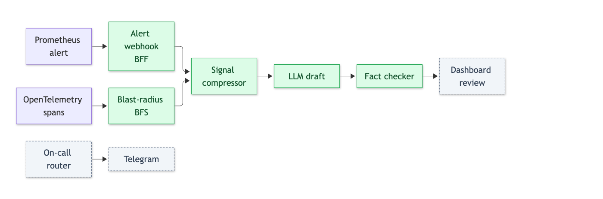
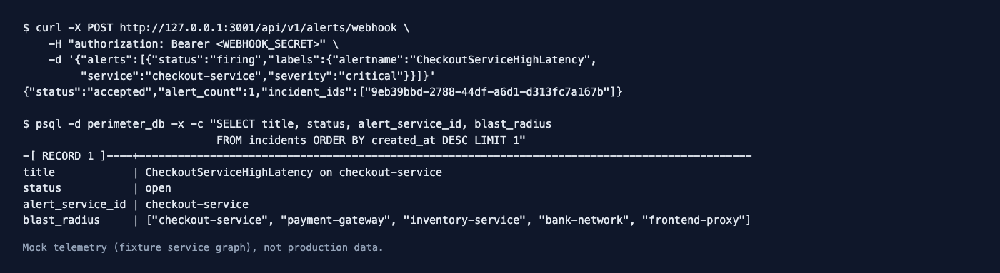
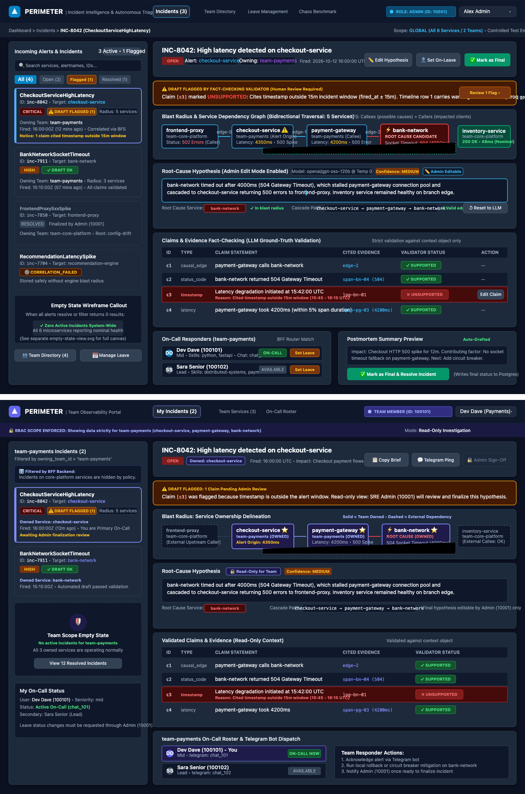
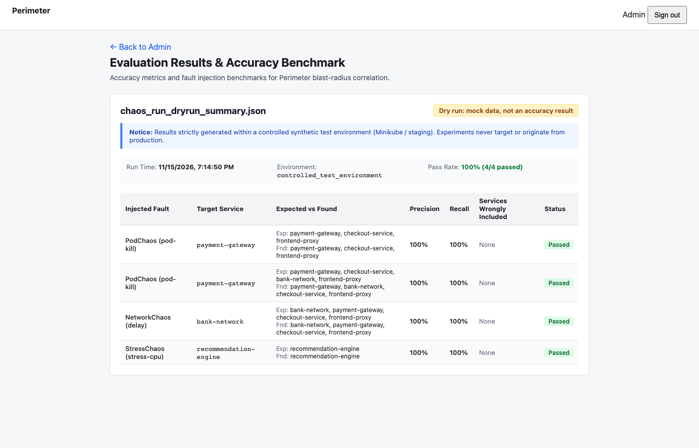

# Perimeter: Product Requirements Document

| | |
|---|---|
| **Version** | v0.2 (15 Nov 2026) |
| **Author** | Sannidhi Durga Pavan Sriram |
| **Context** | Team capstone (6 members). This PRD defines **v1**, the next build phase: what to build, in what order, and how we'll know it works. It starts from an honest assessment of where the project stands today (section 2). |
| **Status of the product** | About 40% of the original proposal is built. All telemetry the engine reasons over is mock data today. |
| **How this was written** | Repo facts were extracted by an AI coding agent into an evidence-cited file (every claim carries a file path; unknowns marked UNKNOWN). Competitor facts come from public pages (sources at the end). Product decisions (user, scope, priorities) are the author's. |

---

## 1. TL;DR

When an alert fires on a Kubernetes service, an on-call engineer has to work out what broke and what else is affected. Perimeter narrows that to the services causally linked to the alerting service (a deterministic walk over a trace-derived call graph), asks an LLM to draft a root-cause report from the ranked evidence, and then **deterministically checks the draft's structured claims** (service references, causal edges, latency, status codes, metric values, timestamps) **against the evidence the model saw**, flagging what it can't support. Free-text narrative in the draft is not yet fact-checked (see sections 2 and 7, S6). A human reviews and finalizes. It is meant to run inside the customer's own infrastructure.

**The v1 bet:** teams that can't or won't trust a black-box AI with production incidents will adopt an RCA assistant whose scoping is reproducible and whose structured claims are machine-checked, with anything unchecked labelled as such. "Trustworthy and auditable" is the product. "Cheaper PagerDuty" is not (see section 5).

## 2. Where the product actually stands

| Area | State (evidence: repo snapshot `main` @ `5630574`) |
|---|---|
| Blast-radius engine (BFS over span graph, upstream/downstream/both, depth-limited) | **Built, tested** |
| Evidence compressor (ranks spans/logs/metrics, trims to token budget) | **Built, tested** |
| LLM draft + claim validator (6 claim types, 4 whole-draft rules) | **Built, tested, with limits.** Structured claims are checked. Free-text fields (summary, impact, contributing factors, next steps, timeline text) are **not** fact-checked, only scanned for service names outside the blast radius. A `metric_value` claim has no metric-name field, so it passes if *any* cited metric is numerically close. The model endpoint is hardcoded to Groq, and there are no retries |
| Alert webhook, incident storage, role-scoped incident list, edit/finalize **API** | **Built** |
| Login, role-based access (admin / team member), Team Directory API | **Built** |
| Chaos Mesh manifests, six instrumented test services, load generator, ground truth, benchmark scorer | **Built, but never run live.** The only recorded result is an offline mock-vs-mock dry run. Ground truth, engine and traces all come from the same fixtures, so the 4/4 pass shows the code is deterministic, not that it works on real traces |
| Dashboard | **Login shell and an admin evaluation page only.** No incident screens |
| Real telemetry into the engine | **Not built.** The alert webhook doesn't fetch or forward spans, so the engine falls back to hard-coded fixtures. The in-cluster OTel Collector only prints spans to a debug log (no trace store). There is no log or metric ingestion of any kind |
| Perimeter's own services inside the cluster | **Not built.** Prometheus, Alertmanager and the OTel Collector run in Minikube, while the engine, backend and Postgres run in Docker Compose. There are no manifests or Helm charts for Perimeter's own services, Alertmanager points at a backend address that doesn't exist in the cluster, and no Prometheus alert rules are committed |
| Alert de-duplication / resolve handling | **Not built** |
| On-call router, Telegram paging of real incidents | **Not built** (design doc plus a "hello" test script) |
| Event store, production deployment (Terraform, Helm, ArgoCD, RDS) | **Not built** (design only) |

Tests: engine 177 passing (99% coverage), backend 45, dashboard 8 (as documented, not re-run for this PRD).

*Figure 1. Architecture from the code repo's README. Green = built, grey dashed = planned. Status: built components run end to end on mock telemetry only.*

*Figure 2. Real output from the running stack: one alert posted to the webhook, then the stored incident and its blast radius. Mock telemetry, not production data. No LLM draft is shown (no model key was set for this capture).*

## 3. Problem

**Hypothesis (not yet validated with users):** during an incident, the first stretch of time goes to answering two questions, *what is actually affected* and *what changed or broke first*, because signals live in separate tools and are not tied to the service dependency graph. Teams in regulated settings can't just paste that telemetry into a third-party AI service.

**What the evidence is and isn't.**
- The project's earlier materials state that engineers lose "20-40 minutes" per incident. **That figure has no citation in the repo.** It should be treated as an assumption until measured (see section 10).
- The "under 90 seconds from alert to reviewed draft" claim in the proposal has **never been timed.**

## 4. Users

These are **hypothesis personas**, to be validated through interviews before v1 scope is locked.

| Persona | Job to be done | What they fear |
|---|---|---|
| **On-call responder** (SRE or platform engineer, team member role) | "When my service alerts, show me what's actually affected and a draft explanation I can sanity-check in a minute." | A confident, wrong explanation that sends them down the wrong path at 3 AM. |
| **SRE lead / admin** (admin role) | "Review drafts quickly, fix them, and finalize a record I can stand behind." Manage teams and who's available. | Wrong drafts becoming the official record. Unreviewable AI output. |
| **Compliance / security stakeholder** (secondary, indirect) | "Show me what data left our environment and how conclusions were reached." | Production telemetry going to an external provider. |

**Target segment (v1 assumption):** engineering teams of roughly 20-200 running microservices on self-managed Kubernetes in settings where data egress is restricted (banking, government, healthcare). Not validated; this is the first thing to test.

## 5. Competitive landscape

| Product | Model | Public pricing (as found) | Self-hosted? | Relevance to Perimeter |
|---|---|---|---|---|
| **PagerDuty** (Advance, AIOps) | SaaS incident management plus AI add-ons | Professional $21-25 and Business $41-49 per user/month (annual vs monthly rates vary by source); Advance AI from $415/month, annual commitment only; AIOps from $699/month | No | Incumbent for routing and paging. Its AI sits behind add-ons |
| **Datadog** (Bits AI SRE / Bits Investigation) | Built into the Datadog platform | AI Credits; Datadog's own estimate is about 6.5 credits per autonomous investigation, and an on-demand credit rate of $0.10 is listed. Older per-investigation pricing (about $25-36) was reported by third parties | No | Strong when you already send everything to Datadog. Only sees what Datadog sees |
| **incident.io** | SaaS, Slack-native | Pro $25/user/month plus $20/user/month for on-call; AI included (per its own pricing pages) | No | Agentic RCA from telemetry, deploys and past incidents (vendor claims) |
| **Rootly** | SaaS, Slack-native | Incident Response $20/user/month, On-Call $20/user/month; AI SRE is sales-quoted | No on-prem option listed in a third-party comparison | AI RCA is a separate, quote-based product |
| **HolmesGPT** (by Robusta; CNCF Sandbox since Oct 2025) | Open-source AI agent that investigates alerts using live observability data | Free (you pay for the model) | Yes. Supports OpenAI, Azure, Bedrock **or a self-hosted LLM** | **Closest competitor to Perimeter's original pitch** |
| **Aurora** (Arvo AI) | Open-source AI SRE platform | Free | Yes, air-gapped and local-model capable (vendor's own claim) | Same segment as HolmesGPT, multi-cloud |

### What this means for positioning (an honest read)

1. **"Self-hosted plus bring-your-own LLM" is no longer a wedge.** Free, open-source, self-hostable AI investigators exist, including a CNCF-backed one. The proposal was written before this was clear.
2. **"No per-seat AI tax" is weaker than it looks.** PagerDuty's AI add-ons are expensive, but Datadog's AI pricing is now credit-based and not obviously costly per investigation. Cost is not a headline.
3. **What remains differentiated, based on the repo:** (a) scoping is a *deterministic, explainable* graph traversal rather than an open-ended agent loop; (b) the draft's structured claims are *machine-checked* against the evidence and unsupported ones are flagged, not hidden (narrative text is not yet covered; see S6); (c) human review is built into the workflow; (d) role-scoped visibility tied to service ownership.
4. **To verify before leaning on (3):** whether HolmesGPT or others already do claim-level validation. In the sources reviewed for this PRD I found no evidence of it, but I did not test their products. This is the key competitive assumption.

**Proposed positioning:** *Incident root-cause drafts you can audit: reproducible scoping, machine-checked claims, human sign-off, inside your own environment.*

This is the v1 *target*. It only becomes honest once S6 (verified vs unverified labelling) and S3 (self-hosted model option) land.

## 5b. Where the positioning outruns the product

These need fixing before anyone external reads the pitch.

| Claim in project docs | Reality | Action |
|---|---|---|
| "Telemetry never leaves your infrastructure" | The draft step sends compressed incident context to Groq's hosted API; no self-hosted-model path exists | Add an OpenAI-compatible endpoint option (story S3) or soften the claim. This needs a new client class, not a config flag: only the model name is configurable, the host is hardcoded. Today the data sent is mock data, so the risk is currently theoretical |
| "Traces the real dependency chain" | The engine uses mock fixtures when no spans are supplied; the webhook handler doesn't forward any, and the in-cluster collector only logs spans | Real ingestion (S1) and refuse-to-draft-on-mock by default |
| "20-40 minutes" saved / "under 90 seconds" | Neither measured | Measure (S5); until then, label as hypotheses |
| "Pages the right responders" | No router or incident paging exists; only a standalone "hello" Telegram test script | Phase 2; remove from v1 pitch |
| "Every claim is fact-checked" (implied by the pitch) | Only structured claim fields are; narrative text isn't, and `metric_value` matches on value alone | S6 |

## 6. Goals and non-goals (v1)

**Goals**
1. Correlate and draft from **real** telemetry, not fixtures.
2. Make drafts **reliably available** and **reviewable** by a human in a UI.
3. **Measure** blast-radius accuracy and draft quality on real fault injection, and publish the numbers, including bad ones.
4. Make the "stays in your environment" claim true, or stop making it.
5. Make the claim-checking promise true: unverified prose must never pass as verified.

**Non-goals (v1)**
- On-call scheduling, escalation policies, status pages, ChatOps (incumbents do these; out of scope on purpose).
- Hundreds of integrations. v1 supports Alertmanager-style alerts and OpenTelemetry traces only.
- Auto-remediation. v1 reads and drafts; it never acts on a cluster.
- Seniority-aware paging (moved to Phase 2: valuable, but not what the core bet depends on, and it already has a detailed spec, unlike v1's ingestion and wiring work).
- Production-grade cloud deployment (Terraform/ArgoCD/Vault). Local and Minikube only in v1.

## 7. Requirements: v1 user stories

Format: *As a [role], I want [capability], so that [outcome].* Status refers to section 2.

### S1. Real trace ingestion and in-cluster wiring (to build)
*As an on-call responder, I want Perimeter to build its dependency graph and evidence from my actual traces, so that its answers reflect my system, not a demo.*

**Prerequisites (not yet in the repo):** deploy the backend and engine where Alertmanager and the OTel Collector can reach them (or bridge Minikube and Compose), and commit at least one Prometheus alert rule so a real alert can fire.

**v1 scope decision:** traces only. Logs and metrics ingestion needs a store that doesn't exist yet (the event store is design-only, P2-2). Until then, drafts rest on trace evidence, and the UI must say so.

Acceptance criteria
- Given spans arrive via OTLP, when an alert fires for a service, then the blast radius is computed from those spans within the configured time window.
- Given no spans are available for the alert window, when a draft is requested, then the system returns a clear "no telemetry" status and **does not** draft from fixtures, unless an explicit mock flag is set.
- Given malformed or oversized span input, then the engine rejects it with a client error and does not crash.
- Given a real Prometheus alert fires in the test cluster, then it reaches the backend and produces an incident without manual steps.

### S2. Alert hygiene (to build)
*As an SRE lead, I want repeated firing alerts to update one incident and resolved alerts to close it, so that I'm not buried in duplicates and the model isn't called repeatedly for the same incident.*

Acceptance criteria
- Given the same alert (same fingerprint) is re-delivered, then exactly one open incident exists and no second draft is generated.
- Given a `resolved` notification arrives, then the matching incident is marked resolved.
- Given an alert for an unknown service, then it is stored with an explicit status (e.g., "no blast radius"), not as a silent empty open incident.
- Given a firing alert carries a `startsAt` time, then `fired_at` (stored and sent to the engine) equals it, not the backend's wall-clock time. This is a bug today and skews the validator's ±15-minute timestamp window for delayed or re-delivered alerts.

Note: this needs a schema change (a fingerprint column and a unique index), and the repo has no migration runner yet, only one manually applied migration file.

### S3. Reliable drafts and a self-hosted model option (to build)
Groq-only today: the host is hardcoded and the draft path has no retry. A self-hosted option needs a new client class, not a config change.

*As a compliance stakeholder, I want the option to run the LLM step against a model inside our environment, so that incident telemetry doesn't leave it.*

Acceptance criteria
- Given a configured OpenAI-compatible endpoint, when a draft is requested, then no request is sent to any external model provider.
- Given a rate-limit (HTTP 429) or transient model failure, then the draft is retried with backoff and queued, and the incident is not left permanently without a draft.
- Given two alerts within one minute, then both eventually get drafts.

### S4. Review and finalize in the UI (backend built, UI to build)
*As an SRE lead, I want to see an incident's blast radius, the draft, and which claims were flagged and why, then edit and finalize it, so that the official record is something I've checked.*

Acceptance criteria
- Given I'm a team member, then I see only incidents on services my team owns; given I'm an admin, I see all.
- Given a draft has flagged claims, then each flagged claim is visually marked with the reason and the evidence it was checked against.
- Given I edit and finalize, then the original model output is preserved, my edits are stored with my identity and timestamp, and the incident status becomes final.
- Given an incident is already final, then a team member cannot edit it.

*Figure 3. Existing wireframes for the planned review UI (not yet built). Admin view (top) and team member view (bottom).*

### S5. Measured accuracy (to build)
*As an evaluator (and as the team), I want accuracy numbers from real fault injection, so that claims about Perimeter are measured, not assumed.*

Acceptance criteria
- Given the instrumented test services are deployed and chaos scenarios run live, then blast-radius precision and recall are recorded per scenario against ground truth (pass threshold: at least 0.80 each, as defined in the scorer).
- Given N drafts are generated, then the report states the share fully supported, flagged, rejected, and the most common flag reasons.
- Given a run uses mock data, then its output is labelled as such and cannot be mistaken for an accuracy result.

*Figure 4. The built admin Evaluation Results page, running locally. The offline dry run is labelled "mock data, not an accuracy result"; it is not a measured accuracy.*

### S6. Don't let unchecked prose pass as verified (to build)
*As an on-call responder, I want to know which parts of a draft were machine-checked and which weren't, so that I never mistake fluent text for verified fact.*

Acceptance criteria
- Given a draft, then every statement is shown as either backed by a validated claim or marked "unverified" in the UI.
- Given the model writes narrative (summary, impact, contributing factors, next steps), then v1 either renders it from validated claims or labels it unverified. It never appears in the same style as a verified statement.
- Given a `metric_value` claim, then it carries the metric name and service and is matched on name, service and value, not value alone.
- Given a draft whose structured claims are all supported but whose narrative is unverified, then its status is not shown as plain "ok".

### Phase 2 (not in v1)
- **P2-1 On-call router and Telegram paging:** pair responders by skill, seniority and availability, using the existing Team Directory data. Spec exists (`docs/router-scoring.md`) and is untested.
- **P2-2 Event store and fetcher** (design only today).
- **P2-3 Cloud deployment** (IaC, GitOps, secrets management).

## 8. Prioritization

RICE, with my own estimates. Effort is in person-weeks, mapped from the audit's S/M/L sizing; Reach is on a 1-10 scale. **These are judgment calls, not measurements.**

| Item | Reach | Impact | Confidence | Effort | RICE |
|---|---|---|---|---|---|
| S2 Alert dedupe and resolve | 10 | 1 | 90% | 1 | **9.0** |
| S6 Verified-vs-unverified labelling + metric-name claims | 10 | 3 | 70% | 3 | **7.0** |
| S3 Draft retry/queue + self-hosted model | 8 | 2 | 80% | 2 | **6.4** |
| S4 Review/finalize UI | 10 | 2 | 80% | 3 | **5.3** |
| S1 Real trace ingestion + in-cluster wiring | 10 | 3 | 80% | 6 | **4.0** |
| S5 Live chaos run + measured accuracy | 5 | 3 | 80% | 3 | **4.0** |
| P2-1 On-call router + Telegram | 8 | 2 | 50% | 5 | 1.6 |
| P2-3 Cloud deployment (IaC/GitOps) | 5 | 1 | 50% | 6 | 0.4 |

Sequencing note: S1 and S5 both depend on the cluster wiring gap in section 2, and S5 only produces a *meaningful* accuracy number once S1 lands, so they ship together. S4 doesn't depend on either (it works on today's data), so it can proceed first.

## 9. Success metrics

| Metric | Why it matters | Baseline today | v1 target (proposed) |
|---|---|---|---|
| **Median time from alert to a draft ready for review** (north star) | The core promise. Today it's unmeasured | Unmeasured | Measure first; target set after baseline |
| **Blast-radius precision and recall** | Is the scoping right? | Mock-vs-mock only (not a result) | At least 0.80 each, on live fault injection |
| **Share of drafts fully supported by evidence** | Is the draft trustworthy? | 3 of 10 stored drafts, all generated from the same mock fixtures, so this reflects how often the validator is satisfied by mock data, not real-world quality | Set after live baseline; report flag reasons |
| **Share of draft statements backed by a validated claim** | Is the "machine-checked" promise real? | Not measured; narrative fields are not checked at all | Report it, then raise it release over release |
| **Draft availability rate** (alerts that end up with a draft) | Reliability | Known to drop under bursts (rate limit) | Near 100% with queue and retry |
| **Reviewer edit rate / time to finalize** | Is it saving effort or creating work? | n/a (no UI) | Measure in pilot |

**Guardrail:** a *cleared* (unflagged) draft that a reviewer later finds materially wrong. This is the failure that destroys trust, so it must be tracked even though it will be rare.

## 10. Validation plan: what we don't know

1. **Do target users have this problem?** Interview 5-8 on-call engineers (SRE/platform) about their last two incidents: where time went, what tools they used, what they'd trust an AI to do. Replace the "20-40 minutes" assumption with real data.
2. **Is data egress the real blocker?** Ask whether restrictions on sending telemetry to third parties actually stop adoption of SaaS AI tools, or whether it's a manageable procurement step.
3. **Is claim validation a differentiator users value?** Show the flagged-claims view to responders and ask whether it changes how much they'd trust a draft.
4. **Competitive check:** test whether HolmesGPT (or similar) already surfaces unsupported claims. If yes, the wedge narrows to ownership-scoped visibility and reproducible scoping.

## 11. Risks

| Risk | Mitigation |
|---|---|
| Trace-edge-only causality misses links via queues, shared databases or noisy neighbors | Documented limitation; one chaos scenario already tests the decoupled case. Consider additional edge sources later |
| The validator checks structured claims only against the context the model was shown, not against ground truth, and doesn't check narrative text at all | Label verified vs unverified in the UI (S6); measure end-to-end draft correctness separately |
| Evaluation on self-injected faults doesn't prove production performance | Label every result as controlled-environment; seek a pilot |
| Small test topology (6 synthetic e-commerce services) | Scope claims accordingly; expand scenarios |
| Prompt injection via service-written log text (log text goes into the model prompt unsanitized) | Documented in the team's 8 Nov audit (N-16); fix before any real deployment |
| A known default admin password (`perimeter-dev`) is seeded into every fresh database, including the Compose stack | Dev-only today; replace with generated credentials before any deployment beyond localhost |
| Backend rate limits are per-process memory, and schema changes are manual SQL | A shared store and a migration runner before running more than one replica |
| Free-tier model limits cause lost drafts | Queue and retry (S3) or self-hosted model |

## 12. Roadmap

- **Now:** S2 (dedupe/resolve), S6 (verified vs unverified labelling, which makes the core promise true), S3 (retry + endpoint option), S4 (review UI, works on current data).
- **Next:** S1 and S5 together: cluster wiring, real trace ingestion, then the first live chaos run and honest accuracy numbers.
- **Later:** On-call router and paging; event store; production deployment; pilot with a real team.

---

## Sources

Repo facts: an evidence-cited summary generated from the repository at `main` @ `5630574` (not committed to the repo), plus the capstone proposal, 8 Nov codebase audit and progress report.

Competitor and market facts (public pages; third-party pricing summaries can lag, so verify before quoting):
- [PagerDuty pricing: AIOps and Advance](https://www.pagerduty.com/pricing/aiops/) and [third-party breakdown](https://spike.sh/blog/pagerduty-pricing-breakdown-2025-and-how-to-save-85/)
- [PagerDuty Advance annual-commitment note](https://usagepricing.com/blueprint/pagerduty)
- [Datadog pricing page](https://www.datadoghq.com/pricing/?cq_net=o) and [Dash0 on Bits Investigation / AI Credits](https://www.dash0.com/comparisons/datadog-bits-ai-alternatives)
- [incident.io pricing comparison](https://incident.io/blog/incident-management-pricing-comparison-2026) (vendor source)
- [Rootly pricing](https://rootly.com/pricing) and [Better Stack comparison](https://betterstack.com/community/comparisons/rootly-vs-squadcast/)
- [CNCF: HolmesGPT](https://www.cncf.io/blog/2026/01/07/holmesgpt-agentic-troubleshooting-built-for-the-cloud-native-era/) and [HolmesGPT overview (self-hosted LLM support)](https://tekanaid-website.pages.dev/posts/holmesgpt-a-kubernetes-troubleshooting-assistant)
- [Arvo AI: Aurora vs HolmesGPT](https://www.arvoai.ca/blog/holmesgpt-alternative-multi-cloud) (vendor source for Aurora)
